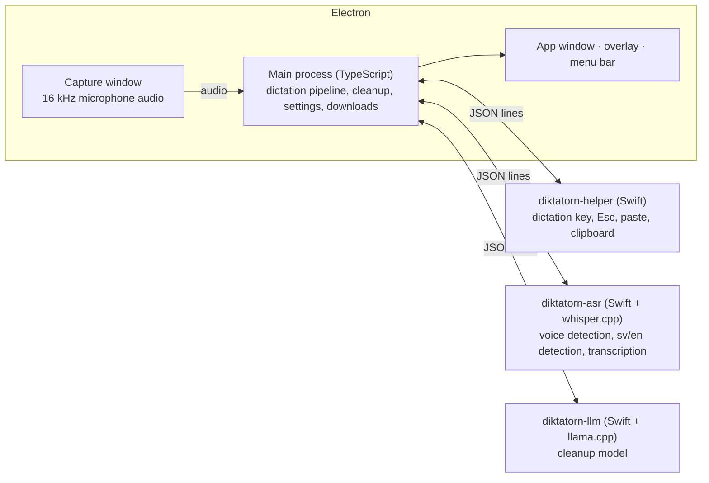

# Diktatorn

Local dictation for macOS that speaks Swedish first and English too. Hold **fn**, talk, release, and the text appears wherever you were typing. Speech recognition, language detection and text cleanup all run on your Mac: no account, no cloud service, and no audio ever leaves the machine.

- **Swedish and English, detected for every dictation.** Swedish goes to [KB-Whisper](https://huggingface.co/KBLab/kb-whisper-medium), the National Library of Sweden's Whisper model trained on Swedish speech. English goes to Whisper large-v3 turbo.
- **Cleanup that cannot put words in your mouth.** Hesitations (*eh*, *öh*, *um*) and self-corrections (*klockan tre, nej förlåt, fyra*) are removed by a small local language model, Gemma 4 E2B. Its answer is only used to decide which of your words to delete. Anything that adds, changes or reorders a word is rejected.
- **Your words, spelled your way.** A personal dictionary fixes terms the recogniser gets wrong and nudges it towards them in the first place.
- **Works in every app.** Text is pasted into the focused field and your clipboard is put back afterwards.
- **Push-to-talk or hands-free.** Hold the key to talk, double-tap for hands-free, Esc to cancel. The key can be fn or a right-hand ⌥, ⌘ or ⌃.

<!-- bench:start -->
## Benchmark

Word error rate (lower is better) on 54 sentences read by one speaker on an M1 Max, compared with stock Whisper large-v3 turbo on the same recordings. The method, every transcript, and how to reproduce it are in [bench/](bench/README.md).

**Main set:** 36 sentences, each with an English technical term.

| | Swedish | English | Mixed | Terms spelled right | Median time |
|---|---:|---:|---:|---:|---:|
| Stock Whisper large-v3 turbo | 2.1% | 1.3% | 42.1% | 29/36 | 0.9 s |
| **Diktatorn** | 7.8% | 1.3% | 22.0% | 22/36 | 1.1 s |
| Diktatorn + dictionary | 5.0% | 1.3% | 18.3% | 28/36 | 1.1 s |
| Diktatorn with KB-Whisper large | 3.5% | 1.3% | 5.5% | 24/36 | 1.4 s |

**Held-out set:** 12 everyday Swedish sentences and 6 more mixed ones, recorded later to check decisions made on the main set.

| | Swedish | Mixed | Median time |
|---|---:|---:|---:|
| Stock Whisper large-v3 turbo | 2.3% | 16.0% | 0.9 s |
| **Diktatorn** | 0.8% | 19.8% | 1.1 s |
| Diktatorn with KB-Whisper large | 1.5% | 18.5% | 1.5 s |

**What the numbers show:**
- **Everyday Swedish:** Diktatorn makes a third of stock Whisper's errors.
- **English brand names inside Swedish speech** are its weak spot: KB-Whisper writes *Postgress QL* and *Versel*. Adding the terms to the dictionary fixes some of them, and KB-Whisper large fixes most.
- **Mixed Swedish and English:** stock Whisper often translates one language into the other ("It only happens on mobile" became "Det sker bara på mobilen"). Diktatorn did that less on the main set but not on the held-out set. Over all 18 mixed sentences, its error rate is 21% against stock Whisper's 34%, and 10% with KB-Whisper large.
- **English** is the same model either way, so the result is identical.
- **Acceptance criteria**, set before measuring (English no worse than stock, Swedish and mixed better): English passes. Mixed passes on the main set. Swedish fails on the main set because of the technical terms, and passes on everyday Swedish.
- **Medium is the default** because it is fast and best on everyday Swedish. KB-Whisper large is one switch away under Models, for better terms and mixed speech at about 0.3 s more per dictation.
- **Sample size:** one speaker and 54 sentences, so differences of a word or two are noise.
<!-- bench:end -->

## Install

There's no packaged release yet; Diktatorn runs from source.

**Requirements:**
- an Apple Silicon Mac with macOS 14 or later;
- Node.js 24+;
- the Xcode Command Line Tools (`xcode-select --install`);
- CMake.

```sh
git clone --recurse-submodules <repository-url> diktatorn
cd diktatorn
npm install
npm run build:native   # whisper.cpp, llama.cpp and the three Swift helpers
npm start
```

**First launch:**
- It downloads about 4.5 GB of models from Hugging Face. Each one is pinned to a fixed commit and checked against its SHA-256 before use, and an interrupted download resumes where it stopped.
- macOS asks for three permissions, each explained under [Privacy](#privacy).
- Development builds run as `build/Diktatorn.app`, so the permission prompts say Diktatorn.

## Hardware

Measured on an M1 Max with 64 GB:
- **Memory:** the speech process uses about 1.7 GB. The cleanup model memory-maps its 3.3 GB file, which macOS can page out under pressure.
- **Recommended:** 16 GB. On 8 GB, turning off Smart cleanup should help, but that hasn't been tested.
- **Timing:** the median from releasing the key to text, including cleanup, is 1.1 s with the default Swedish model and about 1.5 s with KB-Whisper large.
- **Not measured:** base M1 and M2 chips will be slower.

## Privacy

**Audio.** Diktatorn listens only while you hold the dictation key, or while hands-free mode is on. The audio stays in memory, is transcribed on your Mac and is then discarded. It is never written to disk.

**Network.** The only network requests are model downloads from Hugging Face, on first launch and when you pick another model. There's no telemetry, analytics, crash reporting, account or update check.

**Permissions:**

| Permission | Why |
|---|---|
| Microphone | To hear you while you dictate. |
| Input Monitoring | To notice the dictation key. The helper reports only that key, Esc, and "another key was pressed", never which keys you type. |
| Accessibility | To paste with ⌘V, and to keep Esc from reaching the app you're typing in while it cancels a dictation. Without it, transcripts are left on the clipboard instead. |

**Clipboard.**
- Your clipboard is restored after each paste, unless you copied something new in the meantime.
- Content from password managers is never restored.
- Dictated text is marked as transient, so clipboard managers don't keep it.

**Stored on disk.** `~/Library/Application Support/Diktatorn` holds three things: `settings.json`, `dictionary.json` and the models. Recent dictations are shown for the current session only and are never saved.

## Architecture



**One dictation, step by step:**
1. **Key down:** the microphone opens.
2. **Key up:** voice detection trims the silence.
3. **Language:** Swedish or English is detected (only those two are compared).
4. **Transcription:** KB-Whisper for Swedish, Whisper large-v3 turbo for English.
5. **Hesitation rules.**
6. **Cleanup model:** a deletion-only pass with a guard.
7. **Dictionary:** your terms are applied.
8. **Paste:** the text goes into the frontmost app and the clipboard is restored.

**Why separate processes:**
- Each native part runs in its own process and talks newline-delimited JSON over stdin/stdout. A crash in a model can't take the app down; the process is restarted after a crash.
- whisper.cpp and llama.cpp each bundle their own copy of ggml, so they can't share a process anyway.

**Where things live:**

| Path | What |
|---|---|
| `src/main` | Electron main process: dictation pipeline, hotkey state machine, cleanup, settings, model downloads |
| `src/renderer` | App window, overlay, debug window, microphone capture |
| `native/helper` | Swift: dictation key (event tap and HID), Esc, paste and clipboard restore |
| `native/asr`, `native/llm` | Swift processes linking whisper.cpp and llama.cpp (git submodules in `native/vendor`) |
| `bench` | Accuracy benchmark: sentences, harness and results |
| `test` | Unit tests, plus integration tests that run the real models |

Every design choice, with the alternatives considered, is recorded in [docs/DECISIONS.md](docs/DECISIONS.md).

## Development

```sh
npm test            # unit and integration tests (integration tests skip if models are missing)
npm run typecheck
npm run bench       # accuracy benchmark, see bench/README.md
```

The debug window (menu bar icon → Debug Window) shows each dictation's raw and cleaned transcript, the language decision and per-stage timings.

## Limits

- **macOS on Apple Silicon only.**
- **One dictation, one language.** A dictation that switches language goes to one model, so it can garble the part in the other language.
- **Cleanup only deletes.** It never fixes grammar or rewrites.

## Licence

Diktatorn is licensed under the [GNU General Public License v3.0](LICENSE). You may use, study, change and share it. Anything you distribute that is based on it must be released under the same licence, with its source code.

## Credits

[whisper.cpp](https://github.com/ggml-org/whisper.cpp) and [llama.cpp](https://github.com/ggml-org/llama.cpp) (MIT); [KB-Whisper](https://huggingface.co/KBLab) by KBLab, National Library of Sweden (Apache-2.0); [Whisper](https://github.com/openai/whisper) by OpenAI (MIT); [Silero VAD](https://github.com/snakers4/silero-vad) (MIT); [Gemma 4](https://huggingface.co/google) by Google (Apache-2.0); [Electron](https://www.electronjs.org) (MIT).
